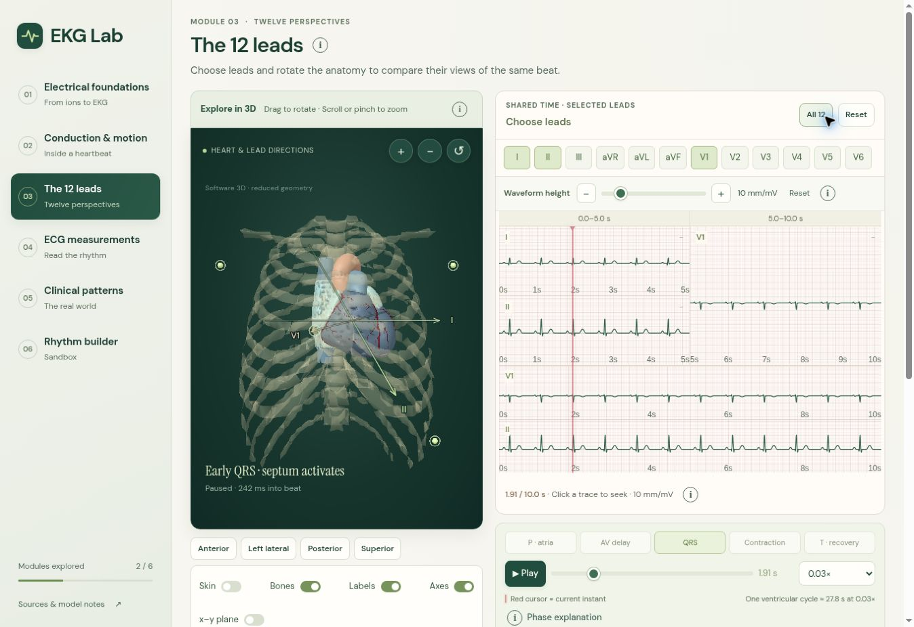

# EKG Lab

An interactive, first-principles electrophysiology teaching lab: follow ion currents into membrane voltage, cardiac activation, a surface lead, and clinical ECG patterns.

**[Open the live demo](https://ekg-first-principles-lab.zhuou557737.chatgpt.site)** · [GitHub repository](https://github.com/o-zhu/ekg-first-principles-lab) · [User guide](docs/USAGE.md) · [Architecture](docs/ARCHITECTURE.md) · [Methods and reproducibility](docs/REPRODUCIBILITY.md) · [Sources](docs/REFERENCES.md)

EKG Lab is an educational preview for medical learners, educators, and developers interested in electrophysiology visualization. It is not validated for clinical diagnosis or treatment. Recorded ECGs, reference anatomy, illustrative motion, and fitted electrical fields are explicitly distinguished throughout the interface.



*Live version 22 in Chrome, using the software 3D fallback. Reference anatomy: BodyParts3D, © The Database Center for Life Science, CC BY 4.0; preparation credit: OrganUI. Screenshot and interface: o-zhu. See [notices](THIRD_PARTY_NOTICES.md).*

## Explore six connected modules

| Module | What you can explore |
| --- | --- |
| **01 · Electrical foundations** | Membrane voltage, traveling excitation, lead voltage, human optical recordings, and a CT-derived four-chamber forward model. Optional channel-structure, pharmacology, and electrolyte explorers connect mechanisms to action potentials. |
| **02 · Conduction & motion** | Rotate the heart, switch between surface anatomy and electrical cutaway, vary playback speed, and inspect action potentials at tissue points. |
| **03 · The 12 leads** | Compare selected leads at a shared time, rotate the torso, inspect lead directions, and adjust calibrated waveform gain. |
| **04 · ECG measurements** | Use a stationary trace and calipers to examine waves and intervals. |
| **05 · Clinical patterns** | Explore 24 clinical cases, original recordings, explanatory motion, and precomputed source-field hypotheses with residuals and limitations. |
| **06 · Rhythm builder** | Combine educational rhythm and conduction settings and compare their consequences. |

The original application includes its lesson system, interactive renderers, action-potential and ECG teaching models, field-to-waveform comparisons, calibrated chart controls, and existing checks. It builds on Three.js and independently credited anatomical, electrophysiological, microscopy, font, and structural datasets. [Third-party notices](THIRD_PARTY_NOTICES.md) identify those contributions and their licenses.

## Quick start

The app is **buildless**. The files in `dist/` are editable HTML, CSS, and ES modules, including inline shaders; they are the application source, not a generated JavaScript bundle. There is no backend, API key, account, or environment file needed to run it.

Prerequisites for the documented developer setup:

- Node.js 24 and its npm package manager (see [`.nvmrc`](.nvmrc)).
- Python 3.10 or newer for the standard-library asset downloader/verifier.
- A current browser with JavaScript and WebGL support. A software rendering fallback exists, but it is not equivalent to every WebGL feature.

For the prepared offline release, extract `ekg-lab-source-v0.1.0.zip` and keep `ekg-lab-runtime-v0.1.0.zip` beside the resulting `ekg-lab/` folder. From that project folder:

```sh
npm ci
npm run setup:assets -- --archive ../ekg-lab-runtime-v0.1.0.zip
npm run assets:verify
npm start
```

Open **http://127.0.0.1:8000/**. Keep the server running while using the lab. Opening `dist/index.html` through `file://` will not reproduce normal module and data loading.

The source release and runtime asset ZIP are separate. The [v0.1.0 educational preview](https://github.com/o-zhu/ekg-first-principles-lab/releases/tag/v0.1.0) provides the archives; `npm run setup:assets` can download the verified runtime bundle automatically. [Asset publication status](docs/ASSETS.md#publication-status) records that distinction.

The downloader reuses valid local files and validates the archive and each extracted asset against [`data/asset-manifest.json`](data/asset-manifest.json). It accepts an explicit `--url` for a mirror and `--archive` for a local bundle; neither changes the expected hashes. It never refits the scientific models. See [asset setup](docs/ASSETS.md) for storage sizes, license boundaries, optional research files, and recovery from a failed download.

For a quick source-only preview without the large datasets, serve the app and use **Module 1 → The membrane / The wave / The lead** or the stationary chart in **Module 4**. Three-dimensional reference anatomy, clinical recordings, fitted fields, optical movies, and molecular geometry require the runtime bundle; those views are not promised to work before setup.

## First visit

1. Open **Electrical foundations** and move from the membrane to a single lead. The info controls expose the mathematical and experimental detail.
2. In **Conduction & motion**, drag the heart to rotate it, use the in-view speed control, and choose **Explore tissue action potentials**.
3. In **The 12 leads**, compare a few leads before selecting all twelve. Waveform gain changes the display scale, not the underlying voltage values.
4. Open **Clinical patterns** and compare the original recording with a fitted-model view. A fitted field is a hypothesis on reference anatomy; waveform agreement does not establish the patient's activation map.

Clicking a time point in an animated view resumes playback. Module 4 remains stationary for measurement; changing a Rhythm builder configuration pauses its rebuilt example. Use the explicit pause control when you want a fixed instant. [The user guide](docs/USAGE.md) covers keyboard and pointer controls and the distinct playback clocks.

## Source map and extension points

| Path | Purpose |
| --- | --- |
| `dist/index.html`, `dist/lab.js`, `dist/*.css` | Main shell, six-module navigation, controls, layout, and accessibility. |
| `dist/scenes.js`, `dist/cutaway.js`, `dist/soft-renderer.js` | Anatomy rendering, cut faces, labels, lead axes, and the fallback renderer. |
| `dist/ecg.js`, `dist/charts.js`, `dist/clinical-chart-scale.js` | Teaching signals, ECG charts, calibrated gain, and seeking. |
| `dist/fit-*.js`, `dist/electrical-*.js` | Precomputed-field evaluation, fitted-case views, and electrical overlays. |
| `dist/cardiac-voltage/` | The isolated Module 1 lesson, its molecular/optical/whole-heart views, and supporting methods. |
| `dist/data/`, `dist/models/` | Runtime recordings, field data, anatomy, and nearby provenance. Large files are restored by asset setup. |
| `scripts/` | Existing preparation and verification tools, local server, and release asset setup. |
| `data/` | Public release asset manifest and source/license catalog. |
| `data-source/`, `research/`, `dist/research/` | Retained preparation notes, readable recovered scientific scripts, numerical audits, and optional reconstruction material. |
| `docs/`, `licenses/` | User/developer documentation, references, and full upstream license notices. |

To add a clinical case, start with the loaders/catalog in `dist/lab.js`, the existing recording schemas under `dist/data/`, and the relevant import/check scripts. Preserve original channel names, units, sample rates, provenance, and attribution. Do not relabel a modified or unknown channel as a standard lead. To change a visual layer or label, start with `dist/scenes.js` and `dist/lead-axis-layout.js` and run the associated interaction and label-layout checks. [Architecture](docs/ARCHITECTURE.md) and [contributing](CONTRIBUTING.md) give more specific edit paths.

## Verification

```sh
npm run test:ci       # source-only checks used by CI
npm test              # full existing checks; runtime assets required
npm run assets:verify # verify required asset sizes and SHA-256 hashes
```

The initial export's numerical checks and browser observations are recorded in [verification](docs/VERIFICATION.md). Historical audit JSON files under the scientific directories retain their original scope and date; they are not evidence that the entire pipeline was rerun for this release. The recorded interaction test counts renderer operations in a controlled fixture; it is not a browser frame-rate benchmark.

No production compilation is needed. Deploy the contents of `dist/` after restoring and verifying the runtime assets. Keep their relative paths and serve correct MIME types over HTTP(S). The local server exposes `dist/` only. See [deployment](docs/DEPLOYMENT.md) for subpath, caching, and static-host considerations.

## Scientific and practical limits

- Reference anatomy, optical recordings, and clinical ECGs come from different people. The anatomy is not matched to the displayed patient ECG.
- Optical fluorescence does not establish absolute intracellular millivolts or a single-cell upstroke. Absolute voltage scales and parts of the action-potential model are declared assumptions.
- Main-lesson heart motion is illustrative. Source-field fits use a reduced propagation/volume-conductor model and bounded hypotheses, not a full ionic bidomain simulation or an identified patient mechanism.
- Some fitted cases agree poorly with the recordings. Conditional held-out waveform scores do not validate future rhythm prediction or independent-patient physiology.
- Original optical-movie preprocessing, initial BodyParts3D GLB/LOD conversion, and some initial recording-import scripts were not recovered. Their processed assets and available provenance are included. The retained four-chamber/fitting sources do not close those gaps.
- Full scientific regeneration is optional, expensive, and not part of setup. It was not repeated for this source release. [Reproducibility](docs/REPRODUCIBILITY.md) distinguishes available scripts, upstream inputs, manual assumptions, and missing steps.

If a data view is empty, run asset verification, check the browser console/network panel for a missing relative path, and confirm that you are using HTTP rather than `file://`. If WebGL is unavailable, inspect the displayed fallback notice. Browser/device coverage is limited to what [verification](docs/VERIFICATION.md) actually records; this release does not claim cross-device clinical validation.

## Citation, license, and maintenance

Use [`CITATION.cff`](CITATION.cff) to cite this software, and cite the upstream datasets and methods relevant to your use via [references](docs/REFERENCES.md). Academic citation is requested separately from the license's legal requirements.

Original software and original documentation are released under the **MIT License**. That does **not** relicense the collection of anatomy, recordings, images, fonts, or derived assets. Those retain their individual terms, including CC BY, CC0, ODC-By, OFL, and separate MIT notices. See [`LICENSE`](LICENSE), [`THIRD_PARTY_NOTICES.md`](THIRD_PARTY_NOTICES.md), and the machine-readable source catalog.

This prepared source snapshot is maintained separately from the existing live demo. Synchronization and deployment are manual. [Maintenance](docs/MAINTENANCE.md) describes importing later changes, preserving asset provenance, making releases, and avoiding divergence. No GitHub Pages deployment is configured. Contributions and focused issue reports are welcome; see [CONTRIBUTING.md](CONTRIBUTING.md).

The reviewed source is published at `o-zhu/ekg-first-principles-lab`. The offline distribution includes a clean Git bundle and [publication instructions](docs/PUBLISHING.md). It excludes the original managed hosting history and configuration.
